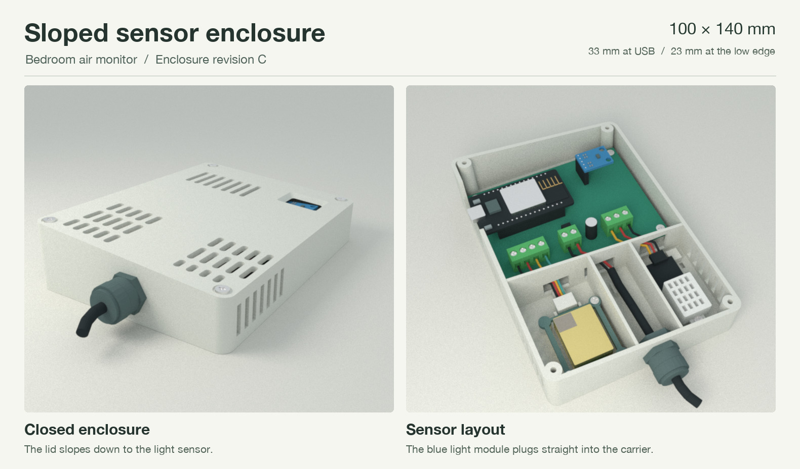
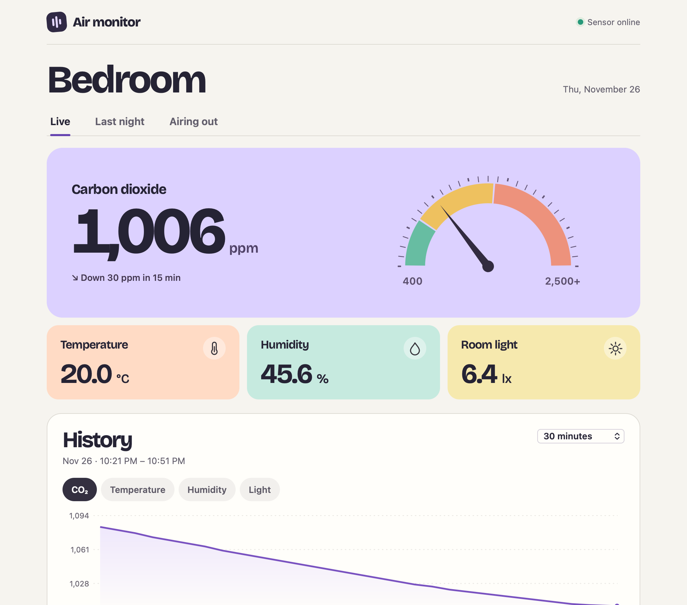
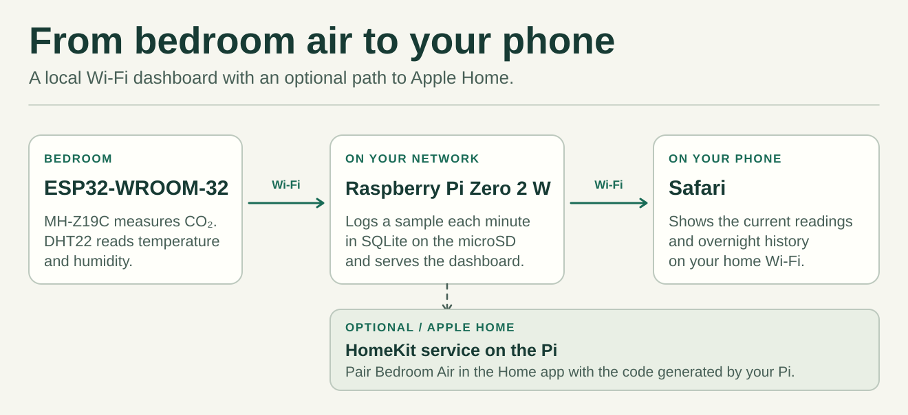

# Bedroom Air

A bedroom CO₂ monitor you can build with an ESP32 and a Raspberry Pi Zero 2 W. Open Safari on your home Wi-Fi to see the room now, how high CO₂ climbed last night, and how much the temperature fell during a likely airing event.

## Build one

1. **Choose the parts.** Start with the 30-pin ESP32-WROOM-32, terminal-type Winsen MH-Z19C and DHT22 breakout. The BH1750 light sensor is optional. The parts list includes module variants, the Pi, power, and links to the carrier and case fasteners. [Parts list](docs/parts.md)
2. **Check the fit before ordering.** Print the A4 sheet at 100%, measure both 50 mm scale bars, and lay your actual modules on it. Then order the bare Rev A carrier and print the Rev C case. [Fit sheet](hardware/Board-fit-check.pdf) · [Gerbers and drills](hardware/Bedroom-Air-RevA-fabrication.zip) · [Printable parts](hardware/Case/)
3. **Solder and test.** Follow the connector map and staged power checks. The first USB flash can be done with the ESP32 lifted out of its sockets. [Carrier assembly](hardware/Assembly.md) · [Case assembly](hardware/Case/Assembly.md)
4. **Flash the ESP32 and enter your Wi-Fi settings over USB.** Once it joins your network, the live readings page is available at `http://bedroom-air.local/`. [Firmware setup and wireless updates](firmware/README.md)
5. **Set up the Pi for history and Apple Home.** The Pi saves one sample per minute on its microSD and serves the dashboard at `http://air-history.local:8080/`. After setup both devices can run on their own power supplies with the computer asleep. [Pi installation and pairing](pi/README.md)

The sensor and logging software ran on the breadboard prototype. The PCB and enclosure have electrical and digital fit checks. Physical fit and sensor behavior in a finished enclosure still need a first-build check.

## What you’ll see

**Live** refreshes roughly every three seconds. Select CO₂, temperature, humidity, or light to inspect its history. The ESP32 also keeps up to 24 hours of one-minute samples in RAM, which the Pi can collect after a Wi-Fi interruption while the ESP32 stays powered.

**Last night** shows the CO₂ peak, time above your chosen level, and how much of the night had valid data. **Airing out** looks for a sustained CO₂ drop and estimates the indoor temperature change and recovery time. Airing events are inferred from the sensors. The dashboard reports temperature change in °C. A heating bill would require energy-use and tariff data. [Example night report](docs/images/night-desktop.png) · [Phone dashboard](docs/images/live-phone.png)

**Apple Home** can show CO₂, temperature and humidity through the optional HomeKit service on the Pi. Light is available in the web dashboard. Each installation generates its own pairing code. The dashboard images in this repository use generated readings.

## Project files

| What you need | Where to find it |
| --- | --- |
| Arduino C++ sensor firmware, ESP32 web UI and bench sketches | [Firmware](firmware/) |
| Go logger, SQLite storage, Safari dashboard, reports and HomeKit service | [Pi source](pi/) |
| Ask Codex for current readings, recent trends, overnight CO₂ or inferred airing events | [Local MCP setup](mcp/) |
| PCB layout, schematic, local footprints and check reports | [Editable KiCad project](hardware/PCB/) · [Schematic PDF](hardware/PCB/Bedroom-Air-schematic.pdf) |
| Printable base, lid, sensor keeper, test gauge and parametric model | [Enclosure](hardware/Case/) |
| Design generation, rendering and fit checks | [Hardware design tools](hardware/tools/) |
| Prototype photos, wiring diagram and dashboard images | [Gallery](docs/gallery.md) |
