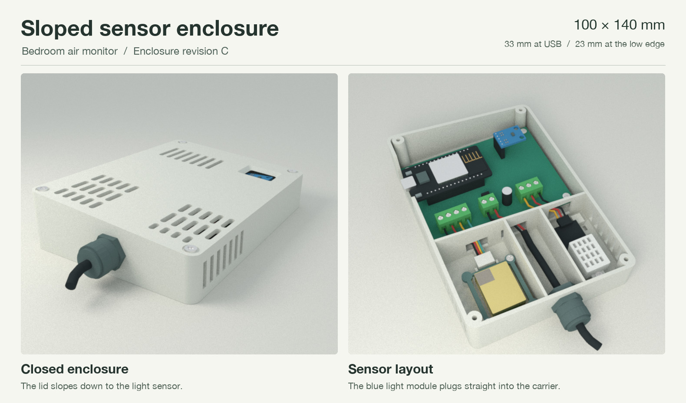
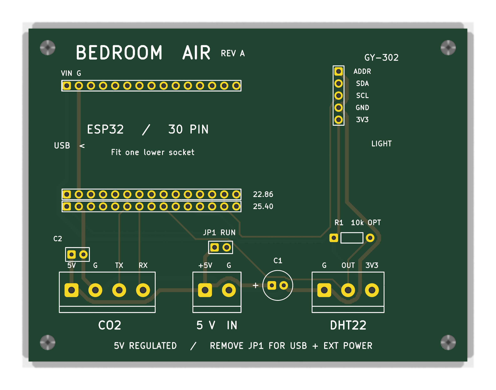
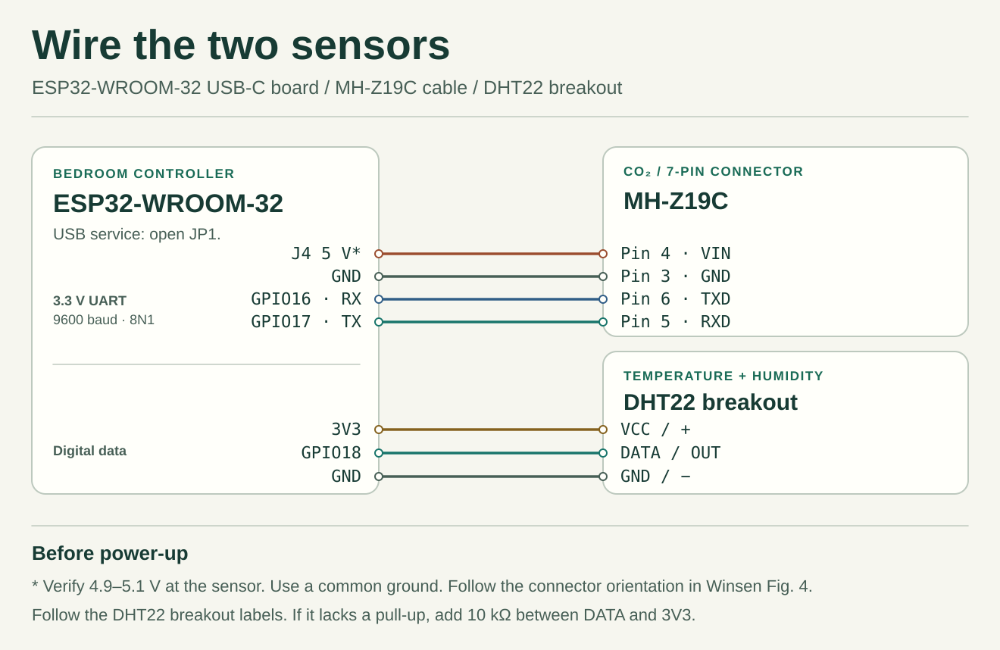
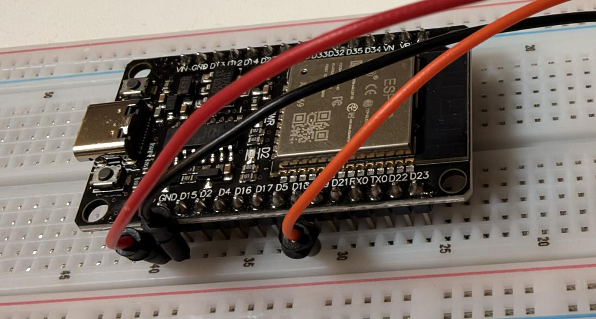
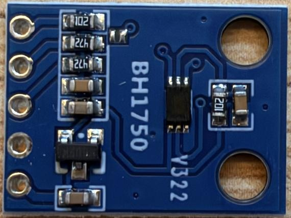
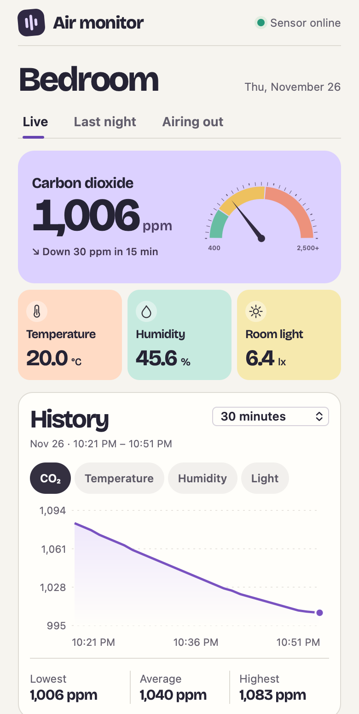
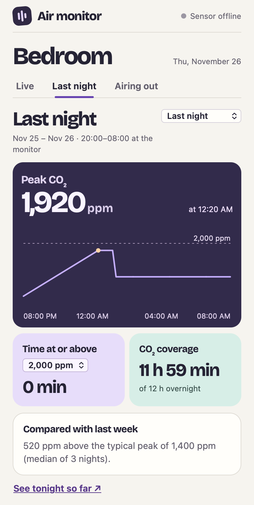

# Build photos and dashboard

**Finished enclosure design.** The open CAD view shows USB on the high side, the GY-302 under the light opening, and the vented bays for the CO₂ and temperature sensors. [Print and assemble the enclosure](../hardware/Case/Assembly.md)

**Carrier and wiring.** The drawing shows the CO₂ and DHT22 signal connections. Use the carrier guide for the 5 V supply, JP1 shunt and optional light module. [Terminal map](../hardware/Assembly.md#terminal-map)

**Prototype and light module.** The first photo shows the ESP32 on the prototype breadboard. The second shows the component side of the BH1750 breakout that faces the lid.

**Dashboard on your phone.** These screens use generated data. The live page is also available on desktop. [Live desktop](images/live-desktop.png) · [Last night on desktop](images/night-desktop.png)

 

[Early visual concept](images/initial-concept.jpg) · [Final printable model](../hardware/Case/)
