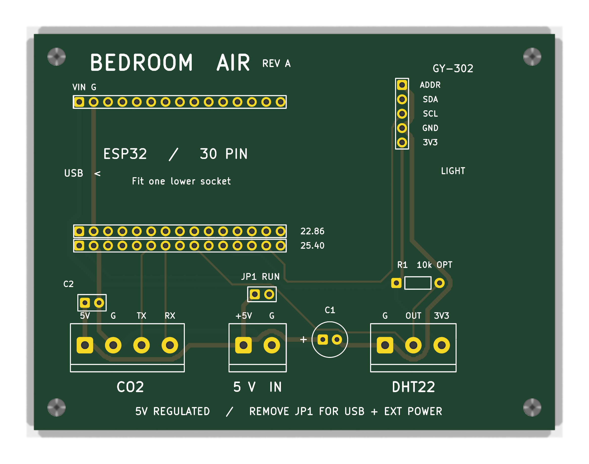

# Parts for one monitor

The module names and critical dimensions below are what to match if a listing changes. The original listing links identify the selected variants. One of each sensor or board is enough.

| Qty | Part | Variant and fit |
| ---: | --- | --- |
| 1 | ESP32-WROOM-32 development board | 30 pins, USB-C, CH340C USB-to-serial. Match the pin labels, USB orientation and one of the two supported header spacings on the [fit sheet](../hardware/Board-fit-check.pdf). [Original listing](https://www.aliexpress.com/item/1005005953505528.html) |
| 1 | Winsen MH-Z19C CO₂ sensor with cable | Terminal type, seven-position plug, marked 400–5000 ppm. Use a mating harness with four accessible leads. A cable with identical white plugs on both ends needs a matching breakout or one cut end. Identify each lead with a continuity meter and insulate the unused ends. [Original listing](https://www.aliexpress.com/item/1005001604646157.html) |
| 1 | DHT22 / AM2302 breakout | The case fits the three-pin PCB version with a mounting tab. Read the +, OUT and − markings on the actual board. [Original listing](https://www.aliexpress.com/item/1005006964237062.html) |
| 0–1 | BH1750 room-light sensor | GY-302 V3.22 with five through-holes. Check which side carries the chip, and solder the straight male header to face the chip toward the lid opening. [Module photo](images/light-sensor.jpg) · [Original listing](https://www.aliexpress.com/item/1005006794832418.html) |
| 1 | Raspberry Pi Zero 2 W | Either header variant works. The ESP32 and Pi communicate over Wi-Fi. [Original listing](https://www.aliexpress.com/item/1005008224603338.html) |
| 1 each | microSD, card reader and Pi power supply | Raspberry Pi OS Lite on the microSD. Use a 5 V supply suitable for the Pi and a micro-USB lead to its **PWR IN** port. |
| 1 each | USB data cable and sensor-node supply | USB-C **data** cable to flash the ESP32. For the finished carrier use a separate regulated 5.0 V supply rated at least 1 A, with a two-wire 5 V lead for J7. |
| 1 set | Rev A carrier and through-hole parts | Two 1×15 female sockets, three 5.00 mm pitch terminals (2-, 3- and 4-position), JP1 header and shunt, capacitors and optional resistor and light-sensor headers. Ratings, quantities, dimensions and placement are in the [carrier BOM](../hardware/Assembly.md#bill-of-materials-for-one-monitor). [Original terminal kit](https://www.aliexpress.com/item/1005007747257807.html) |
| 1 set | Rev C case and fixings | Printed base, lid and CO₂ keeper, M3 and M2.5 hardware, gland, washer and cable ties. Print the small CO₂ fit gauge first. [Fasteners and print settings](../hardware/Case/Assembly.md#hardware) |

For assembly, have a soldering iron and solder, flush cutters, wire stripper, small screwdriver, multimeter, and a ruler or calipers. Heat shrink works for insulating individual unused harness leads. An 830-point breadboard and jumpers are handy for bench tests. The build uses the ESP32 development board directly and needs no expansion board, relay, or separate display.

