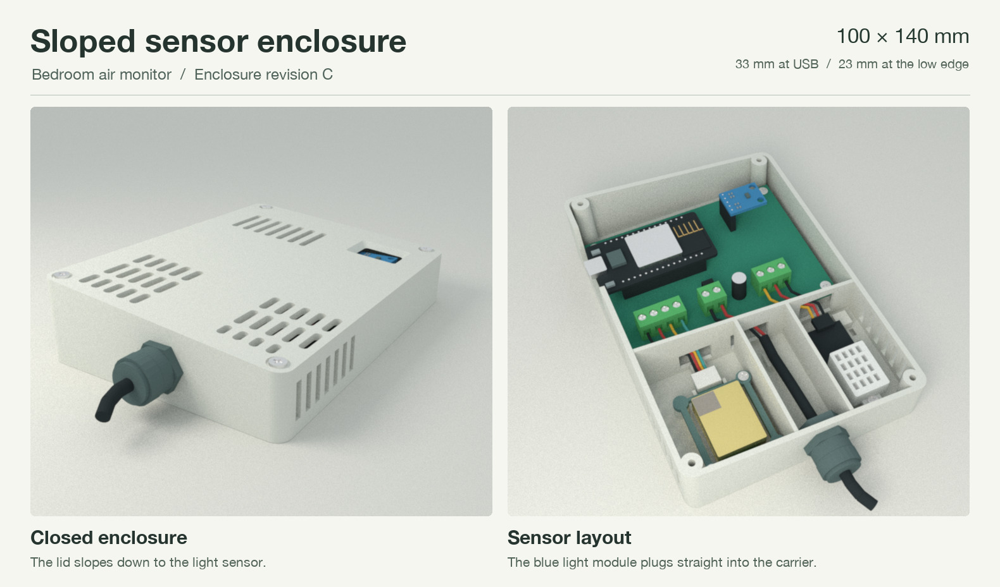

# Print and assemble the sensor enclosure · Rev C

The enclosure takes the 92 × 70 mm carrier PCB, the terminal-type MH-Z19C, and a three-pin DHT22 breakout. The **100 × 140 mm** base sits flat. The single-plane lid slopes 5.7° across the width, from **33 mm high on the USB side to 23 mm at the opposite edge**, excluding screw heads and the gland. The GY-302 plugs directly into J6 beneath the flared light opening. Print the Rev C base and lid as a pair. The Pi stays separate.

## Print

| File | Quantity | Orientation supplied |
|---|---:|---|
| `01-base.stl` | 1 | Flat exterior bottom on the bed |
| `02-lid.stl` | 1 | Flat exterior face on the bed, guide tabs up |
| `03-co2-keeper.stl` | 1 | Flat frame on the bed |
| `04-optional-co2-fit-gauge.stl` | 1 optional | Flat plate down. This duplicates the CO₂ mounting features for an initial fit check. |

Slice at **100% in millimetres**. PETG, a 0.4 mm nozzle, 0.2 mm layers, three or four perimeters and 20% infill are suitable starting settings. Allow 101 × 140 mm of print-bed area plus any brim or skirt. The supplied lid STL already has its sloped exterior face flat on the bed. The lid and keeper print flat. The base has short bridges over its wire passages, a round gland hole, and three small tie saddles. Inspect the bridge preview for your printer. Clear sagging strands from the wire passages and the gland bore before assembly.

**Print the keeper and small gauge first.** Unplug the sensor, handle it by its PCB, and set it film-up on the gauge. The two transverse printed ledges support the exposed green PCB at its free tip and at its neck just before the white connector. The connector projects through the open end. Both ledges must clear solder joints and the plated chamber. Set the keeper down on its four posts. Its narrow crossbars must lie above the same two exposed PCB regions. Two M2.5 × 6 screws hold the frame against the posts. Check that the module stays captured when tilted, the cable plugs in freely, and a slip of paper clears the chamber at the frame. The 2.0 mm vertical slot accommodates the bare PCB with slight play. If the frame rubs the chamber, film or connector, measure the two bare regions and adjust the model before printing the base. A physical fit still needs confirmation on your hardware.

## Hardware

| Quantity | Part | Where it goes |
|---:|---|---|
| 4 | M3 × 6 mm pan-head screws | Carrier to its four standoffs |
| 4 | M3 × 8 mm pan-head machine screws | Lid into the four outside corner posts. Choose heads up to 6.3 mm diameter to fit the level screw seats |
| 2 | M2.5 × 6 mm pan-head machine screws | CO₂ keeper, diagonal pair of holes |
| 1 each | M2.5 × 8 mm pan-head machine screw and small nylon washer | DHT22 mounting tab. Add a thin nylon spacer under the tab if the breakout requires one. |
| 1 | Nylon M12 × 1.5 cable gland and matching locknut | Regulated 5 V lead, round jacket. Choose its grip range to match your cable. The wall hole is Ø12.5 mm through 2.2 mm of plastic. Use an inner locknut no larger than 20 mm across corners. |
| 2–4 | 2.5 mm-wide nylon cable ties | Two sensor harnesses, optional power saddle and optional DHT neck retention |

Screw lengths are measured from under the head. The printed pilots measure Ø2.60 mm for M3 and Ø2.13 mm for M2.5. Start the screws straight by hand. If the printed pilots are tight, hand-tap or chase them while the enclosure is empty. The lid pilot is 7.4 mm deep, the carrier pilot 5.5 mm, and the keeper pilot 4.6 mm.

## Assembly

1. **Fit the power gland.** Feed the disconnected round 5 V lead through the gland and its locknut. Clamp the outside jacket and check that a gentle pull ends at the gland. Follow the central corridor toward the middle screw terminal. A tie saddle halfway along the corridor can hold the jacket. Leave enough slack at the terminal to lift the carrier out for service. Follow the carrier's electrical guide for shunt position and USB use.
2. **Seat the carrier.** With its components facing up, lower the ESP32 USB-C end into the open left-side notch. Install four M3 × 6 screws. The lid posts sit beyond the board edges. Check your USB plug with the lid temporarily in place. Its overmould should pass through the opening and the plug should seat fully. Fit the plug-in light sensor as described below.
3. **Install the CO₂ sensor.** Use the same orientation as the fit gauge. The diffusion film faces up and the factory cable points toward the carrier. Put the keeper on its posts and secure the diagonal screw pair. Route the harness through the left divider opening to its terminal. Anchor the insulated wires at the nearby saddle, leaving a gentle loop at the factory plug. The gold chamber and film need clearance on every side.
4. **Install the DHT22.** In the right-hand bay, point the white tab toward the cable-gland end and the three-pin plug toward the carrier. Line up the tab hole with the round post. Support any gap below the tab with a nylon spacer so the board stays straight, then fit the washer and M2.5 screw. Choose a screw length that gives 3–6 mm of engagement after the tab and washer. The nominal screw is 8 mm long.
5. **Retain the DHT breakout and cable.** If your clone covers the white eye or needs more support, route a thin tie through either matched pair of floor slots and around the bare, unvented black PCB neck. Rest the PCB edges on the two low ribs, lay the tie flat in the underside recess, and keep its locking head inside the case. Choose the slot pair that clears components and the white grille. Use the separate saddle to take strain off the three-pin harness. Feed its free ends through the right divider and into their terminal.
6. **Close the case.** Check that the lid seats on the rim without pinching any leads. Fit its four M3 × 8 screws. Keep the long side inlets, both sensor grilles and the light opening clear in use. The power corridor keeps the external cable away from both sensing surfaces.

## Fit the light sensor

1. Solder an ordinary straight 1×5 female socket at J6 on the carrier and a straight 1×5 male header on the underside of your GY-302. Both use 2.54 mm pitch. The male header’s plastic body sits against the underside of the blue board, with the long mating pins pointing down. If your kit includes a matching straight pin strip, use it here.
2. With power off, plug the module into J6 with the chip facing up. Align the **ADDR** end with carrier J6 pin 1 and **VCC** with pin 5. Seat the header fully. Place the Rev C lid on the base. It should sit on all four posts without touching the module, its solder joints or the inserted USB plug.
3. The model assumes an 8.5 mm-high female socket, a 2.54 mm male-header body, a 1.6 mm sensor PCB and a 0.8 mm chip. This puts the chip about **2.8 mm below the outside roof at the opening center**. Lay a straightedge across the opening and confirm that the actual chip clears it. The breakout stays horizontal when the base rests flat.
4. To test for shading, set a steady lamp beside the monitor and compare a few lux readings in Safari with the lid off and on. Keep the module and lamp still and move your hand out of the light path between readings. The modeled case clears rays 60° from overhead in every sampled compass direction. The physical test also accounts for your header height, print and lamp.

## Fit dimensions

| Feature | Design dimensions or assumptions |
|---|---|
| PCB | 92 × 70 × 1.6 mm. M3 holes on an 84 × 62 mm rectangle, 4 mm from each edge. The PCB underside sits at Z 7.4 mm, 5.2 mm above the inner floor. |
| Interior height | Lid underside slopes from Z 30.6 mm on the left to 20.6 mm on the right. At the light chip center the outer roof plane is at Z 25.2 mm. |
| ESP32 | 30-pin board with USB facing the left wall. The USB opening spans PCB Y 7.8–41.8 mm. Its bottom is at Z 6.8 mm and its sloped lintel is at Z 26.8–27.0 mm. Its outer wall face lies 3 mm beyond the carrier edge. |
| MH-Z19C | Terminal version, 38.8 ± 0.3 mm overall, nominal 19.7 mm across chamber, 8.6 mm high. Measure the bare PCB at both ends. From the tip opposite the connector, the keeper crossbars cover 0.25–1.95 mm and 30.85–32.10 mm. Both rails stay outside the chamber. |
| DHT22 | White AM2302-style body with mounting eye. A 22 × 41.8 mm rectangular breakout envelope was checked, with the mounting eye near the cable-gland end. Check the board underside, plug projection and hole accessibility on your clone. |
| BH1750 | Five-pin header at PCB X 65 mm, Y 9–19.16 mm, module extending toward +X. An ordinary 8.5 mm socket and 2.54 mm header body put the breakout underside 11.04 mm above the carrier top. The opening flares from 18 × 14 mm on the inside to 23 × 19 mm on the outside, measured in plan view. |
| Airflow | Low side inlets and lid grilles in each sensor bay. A 1.6 mm divider separates the electronics from the sensors apart from the cable passages and a 0.4 mm clearance below the lid. |

The mesh checks covered watertightness, solid count and print orientation. The assembly interference checks covered the carrier, ESP32, USB plug envelope, screw terminals, power capacitor, light path, gland nut and both sensor envelopes. Print shrinkage, connector heights, board variants and the enclosure's thermal effect require checks on the assembled unit.

## Edit the design

`enclosure.py` is the editable parametric source. From this directory, run `uv run enclosure.py` to regenerate all four STL files, or `uv run enclosure.py new-prints` to export to a different directory. A Python installation with the dependencies listed at the top of the file also works. Dimensions at the top control the shell, carrier supports, USB mouth, gland, DHT post, CO₂ pads, keeper and roof slope. Working XY coordinates follow the carrier drawing, with the origin at its upper left, X right and Y down.

The manufacturer drawings show the terminal-type Winsen package on page 5 and the bare Aosong package on page 1. The DHT breakout and the USB overmould depend on the hardware you have. [Winsen MH-Z19C manual](https://www.winsen-sensor.com/d/files/manual/mh-z19c.pdf) · [Aosong AM2302 mechanical drawing](https://aosong.com/uploadfiles/2025/04/20250417105409216.pdf)
